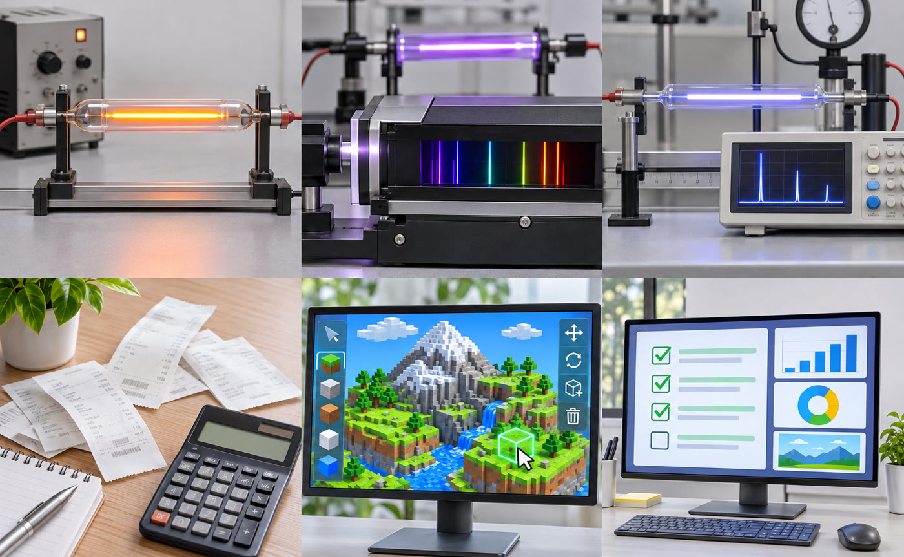

# Gemini 4 in practice

[PT](README.md) · [EN](README.en.md) · [ES](README.es.md)

## About

The project brings together public sources, a comparison, and a validation yardstick to help you choose between Gemini 4 Neon, Argon, and Hydrogen for everyday tasks. You only need a browser to read the guide.

[How to get started](https://inematds.github.io/gemini-4-na-pratica/guia/en/) · [Read the comparison with sources (in Portuguese)](COMPARATIVO.md)

[Watch the analysis and summary](https://www.youtube.com/watch?v=iP57IDdL7e0) · [Watch the Short on YouTube](https://youtube.com/shorts/WEWkoZKwEcU)

## Test with something you need to deliver

> Use the same fictional receipts with all three models. Ask for a table with ID, date, and amount. Flag duplicates and items with no amount. Check the total and record the time until the delivery is validated.

## Technical setup

The guide is static HTML. Open the file below in a browser. The lab and full comparison are in Portuguese. [HTML](guia/en/index.html)

## The process, from start to finish

Give all three models the same data, tools, and attempt limit. Decide in advance what counts as done. Add up the cost of all attempts and divide only by the number of deliverables that passed.

- [Full lab (in Portuguese)](laboratorio/protocolo.md)
- [Download CSV spreadsheet](laboratorio/tentativas.csv)
- [Pricing published by Google](https://aistudio.google.com/docs/pricing)
- [Overall agent index](https://arena.ai/leaderboard/agent)
