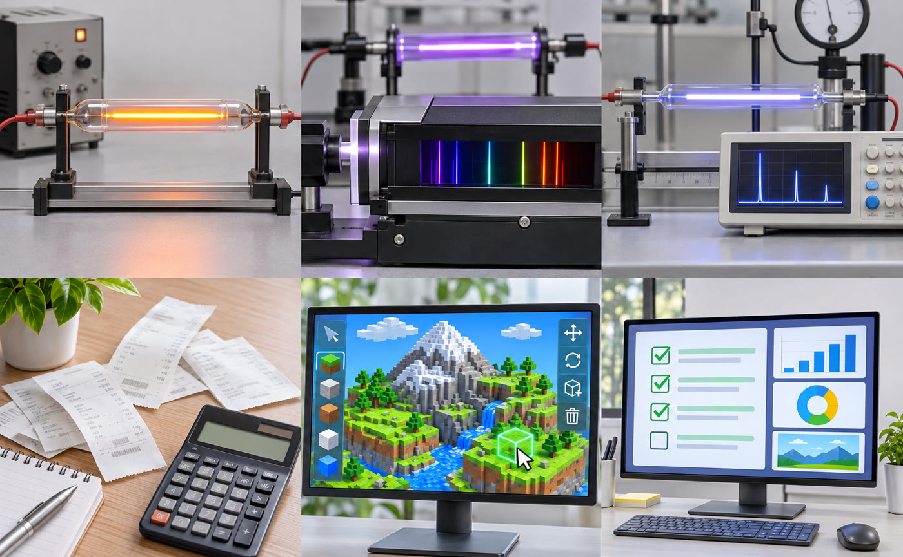

# Gemini 4 en la práctica

[PT](README.md) · [EN](README.en.md) · [ES](README.es.md)

## Qué es

El proyecto reúne fuentes públicas, una comparación y un criterio de validación para elegir entre Gemini 4 Neon, Argon y Hydrogen en tareas de tu día a día. Solo necesitas un navegador para leer la guía.

[Cómo empezar](https://inematds.github.io/gemini-4-na-pratica/guia/es/) · [Lee la comparación con fuentes (en portugués)](COMPARATIVO.md)

[Mira el análisis y el resumen](https://www.youtube.com/watch?v=iP57IDdL7e0) · [Ver el Short en YouTube](https://youtube.com/shorts/WEWkoZKwEcU)

## Prueba con algo que necesitas entregar

> Usa los mismos comprobantes ficticios en los tres modelos. Pide una tabla con ID, fecha y valor. Marca los duplicados y los elementos sin valor. Comprueba el total y registra el tiempo hasta la entrega validada.

## Instalación técnica

La guía es HTML estático. Abre el archivo de abajo en un navegador. El laboratorio y la comparación completa están en portugués. [HTML](guia/es/index.html)

## El proceso, de principio a fin

Dales a los tres modelos los mismos datos, herramientas y límite de intentos. Acuerden de antemano qué cuenta como terminado. Suma el costo de todos los intentos y divídelo solo entre el número de entregas aprobadas.

- [Laboratorio completo (en portugués)](laboratorio/protocolo.md)
- [Descargar hoja de cálculo CSV](laboratorio/tentativas.csv)
- [Tarifas publicadas por Google](https://aistudio.google.com/docs/pricing)
- [Índice general de agentes](https://arena.ai/leaderboard/agent)
